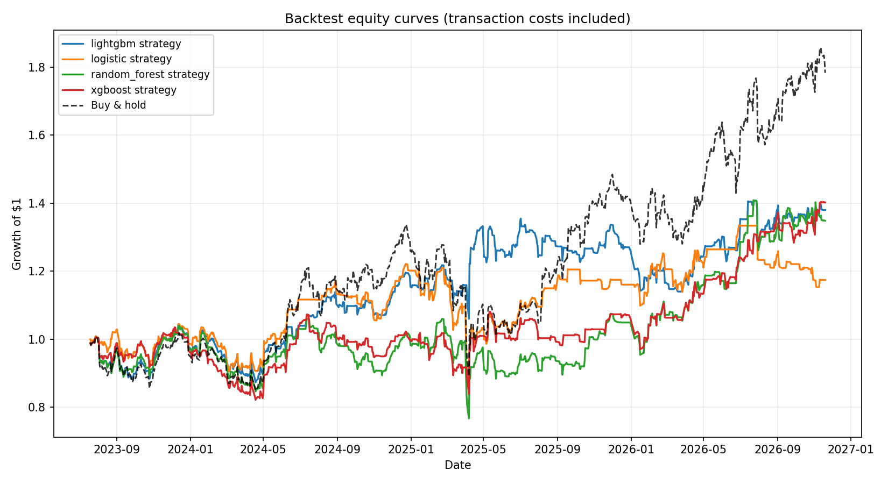

# Stock Direction Predictor

A complete, honest machine-learning project that predicts whether a stock closes **up or down tomorrow**, compares the model against trivial baselines, backtests a cost-aware trading rule, and exposes everything in a Streamlit dashboard.

> **Disclaimer:** This is a learning/portfolio project, **not financial advice**. Next-day stock direction is close to random. A realistic accuracy is ~51–55%, and none of the models below beat the "always predict up" baseline on the AAPL holdout period. That is a normal, honest result.



---

## 1. Problem

- **Target:** `1` if tomorrow's adjusted close is higher than today's, else `0`.
- **Assets:** AAPL, MSFT, GOOGL, AMZN, META, TSLA, NVDA, SPY (+ SPY and VIX as market context).
- **Period:** 2010-01-04 → 2026-11-20, daily bars (~4,200 per ticker).
- **Success criteria:** accuracy vs. baselines, precision/recall/F1/ROC-AUC, walk-forward CV, and a backtest with transaction costs vs. buy-and-hold.

The core hypothesis is deliberately modest: do past returns, trend, momentum, volatility, volume and market context contain *any* exploitable next-day signal after costs?

## 2. Data

Source: Yahoo Finance via `yfinance`, downloaded with `auto_adjust=True` (splits and dividends already applied). Raw CSVs are cached in `data/raw/`; engineered datasets in `data/processed/`. A data-quality report (`missing_weekdays`, NaNs, zero-volume rows, duplicate dates, large jumps) is written to `data/processed/<TICKER>_quality.json`.

## 3. Features (34)

All features at row *t* use information available **at or before the close of day t**. `target` and `next_ret` are never model inputs.

| Group | Features |
|---|---|
| Returns | `ret_1`, `ret_2`, `ret_5`, `ret_10`, `ret_20` |
| Trend | `sma_{5,10,20,50}`, `ema_{5,10,20,50}` (distance from price) |
| Momentum | `rsi_14`, `macd`, `macd_signal`, `macd_diff` |
| Volatility | `vol_10`, `vol_20`, `bb_width`, `bb_pos`, `atr_14`, `hl_range` |
| Volume | `vol_chg`, `vol_ratio` |
| Candle/calendar | `oc_change`, `gap`, `dow`, `month` |
| Market context | SPY and VIX returns / 20-day volatility / SPY volume change |

Leakage checks are asserted in `notebooks/02_features.ipynb` (e.g. `next_ret[t] == ret_1[t+1]`, and target equals the sign of `next_ret`).

## 4. Methodology

1. **Chronological 80/20 split** (no shuffling): train 2010-03-16 → 2023-07-18, test 2023-07-19 → 2026-11-19.
2. **Walk-forward CV:** `TimeSeriesSplit(n_splits=5)` on the training period only.
3. **Tuning:** `RandomizedSearchCV` with the same expanding-window CV, training period only. The test set is scored **once**, after all choices are made.
4. **Models:** Logistic Regression (scaled), Random Forest, XGBoost (tuned), LightGBM. Shallow trees and low learning rates to limit overfitting.
5. **Backtest:** signal at close *t* earns the `t → t+1` return; a 0.1% one-way cost is charged on every position change. No slippage, no leverage, no shorting in the default long/cash mode.

## 5. Results (AAPL holdout, 840 days)

Baselines first — these are the bar a model must clear:

| Model | Accuracy | Precision | Recall | F1 | ROC-AUC |
|---|---:|---:|---:|---:|---:|
| Always predict up | **0.5381** | 0.5381 | 1.0000 | 0.6997 | – |
| Yesterday's direction | 0.5048 | 0.5398 | 0.5398 | 0.5398 | – |
| Logistic Regression | 0.5048 | 0.5377 | 0.5686 | 0.5527 | 0.4787 |
| Random Forest | 0.5274 | 0.5487 | 0.6858 | 0.6096 | 0.4946 |
| XGBoost (tuned) | 0.5143 | 0.5466 | 0.5708 | 0.5584 | 0.4986 |
| LightGBM | 0.5048 | 0.5347 | 0.6128 | 0.5711 | 0.4935 |

**Verdict:** every model is worse than always predicting "up" on this holdout. ROC-AUC is at or below 0.5, i.e. the ranking of probabilities carries no signal. Random Forest scores highest among models but still misses the baseline by ~1.1 pp. Walk-forward CV accuracy was 0.509–0.525, consistent with the test result — this is not a single unlucky period.

### Backtest (threshold 0.5, 0.1% cost per trade)

| Metric | Logistic | Random Forest | XGBoost | LightGBM | Buy & hold |
|---|---:|---:|---:|---:|---:|
| Total return | 17.4% | 34.9% | 40.2% | 38.0% | **78.3%** |
| Annualised return | 4.9% | 9.4% | 10.7% | 10.1% | **19.0%** |
| Annualised volatility | 21.4% | 22.7% | 20.0% | 20.8% | 26.4% |
| Sharpe | 0.33 | 0.51 | 0.60 | 0.57 | **0.79** |
| Sortino | 0.38 | 0.64 | 0.84 | 0.78 | **1.10** |
| Max drawdown | 30.8% | 27.6% | 21.8% | **16.3%** | 33.4% |

The strategies take only ~30–40% market exposure and therefore have lower volatility and drawdowns, but none beats buy-and-hold on total return or Sharpe. Lower drawdown is a property of being out of the market, not evidence of predictive skill.

### Multi-ticker check (XGBoost, same setup)

| Ticker | Test accuracy | ROC-AUC | Walk-forward CV | Strategy return | Buy & hold |
|---|---:|---:|---:|---:|---:|
| AAPL | 0.5143 | 0.4986 | 0.5252 | 40.2% | 78.3% |
| MSFT | 0.4905 | 0.5116 | 0.5156 | -4.2% | 40.2% |
| TSLA | 0.5110 | 0.5356 | 0.5101 | 53.7% | 48.3% |
| SPY | 0.5321 | 0.4988 | 0.5091 | 26.7% | 57.7% |

The model is not consistently good on any asset; TSLA's slightly better rankings do not translate into a reliable edge. Results across tickers and periods are in `reports/*.csv` and `reports/*_summary.json`.

## 6. Interpretation

- `src/cli.py explain` produces a SHAP summary plot (`reports/figures/AAPL_xgboost_shap.png`) and a feature-importance CSV.
- `reports/AAPL_xgboost_error_analysis.csv` breaks accuracy down by volatility quintile — the typical failure mode is high-volatility regimes and sharp reversals.

## 7. Limitations

- No guarantee of profit; next-day equity direction is near-random once costs are included.
- Transaction costs are modelled but **slippage, spread, queue position and market impact are not**.
- The test window (2023–2026) is one regime; a different window can produce different numbers.
- Adjusted prices assume splits/dividends are handled correctly by the data vendor.
- Feature importance is associational, not causal; SHAP does not prove a tradable edge.
- Tuning on many tickers/models creates selection bias — the headline accuracy here is deliberately not cherry-picked.

## 8. How to run

```bash
# macOS: XGBoost/LightGBM wheels need OpenMP
brew install libomp

python3 -m venv venv
source venv/bin/activate            # Windows: venv\Scripts\activate
pip install -r requirements.txt

# 1. Data
python -m src.cli download --tickers AAPL MSFT GOOGL AMZN META TSLA NVDA SPY '^VIX' --start 2010-01-01
python -m src.cli prepare --tickers AAPL MSFT TSLA SPY --market

# 2. Train and evaluate once on the holdout
python -m src.cli train --ticker AAPL --model xgboost --with-market --tune

# 3. Evaluate all saved models / generate the comparison chart
python -m src.cli report --ticker AAPL --with-market

# 4. SHAP explanation
python -m src.cli explain --ticker AAPL --model xgboost --with-market

# 5. Streamlit dashboard
streamlit run app/streamlit_app.py
```

Handy shortcuts are in the `Makefile` (`make setup`, `make train`, `make report`, `make app`). Notebooks `01_eda`, `02_features`, `03_modeling` walk through the same workflow interactively.

## 9. Project structure

```
data/raw/            cached yfinance OHLCV CSVs (gitignored)
data/processed/      engineered features + data-quality reports (gitignored)
notebooks/           01_eda, 02_features, 03_modeling
src/data.py          download, validate, clean, prepare
src/features.py      point-in-time feature engineering, leakage-safe labels
src/models.py        estimators, walk-forward CV, tuning, artefact I/O
src/evaluate.py      baselines, comparison tables, error analysis
src/backtest.py      cost-aware strategy, performance metrics, charts
src/cli.py           command-line workflow
app/streamlit_app.py dashboard
models/              saved joblib artefacts + JSON metadata (gitignored)
reports/             CSV tables, SHAP plot and figures
```


Built for learning and portfolio purposes. No returns are guaranteed.
